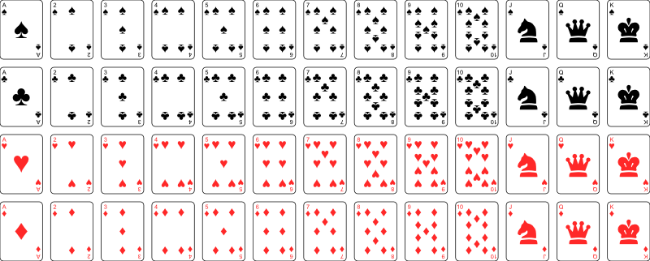

# QuickVectors.Export.Svg.FSharp

# Templates

These can be used to create basic versions of some collective designs which can then be manipulated as required.

- The [Template Module](#the-template-module)
    - [Playing Cards Template](#playing-cards-template)
- [Viewing A Template](#viewing-a-template)
- [Issues, Questions, and Suggestions](#issues-questions-and-suggestions)

## The Template Module

The `Template` **module** contains functions to create templates, which are:

| Template.                     | Provides a template of            |
| ----------------------------- | --------------------------------- |
| **Games.playingCards**        | Standard playing cards            |

> **Notes:** 
>
> 1. The module is actually contained in the `QuickVectors.Elements.FSharp` package but it is documented here for convenience.
>
> 2. The form and/or content of each template can change between package versions so you should not rely on getting the same output after upgrading.
>
> 3. As with the patterns in this package there is no underlying unit of measure.
>
> 4. These templates are intended for digital illustration/mock-up purposes only. It is not recommended that you use them for physical production.

### Playing Cards Template



When generating the playing cards template you need to supply four parameters:

- `cardWidth` : The width of each playing card;
- `cardHeight` : The height of each playing card;
- `columnGap` : The gap between each column of cards;
- `rowGap` : The gap between each row (suit) of cards.

An example of specifying the template is:

```fsharp 
Template.Games.playingCards 63.5 88.9 8.0 8.0 // Poker card ratio.
```

The cards will be arranged with one suit in each row and the cards from ace to king (inclusive) from left to right.

The faces of the ace to ten (inclusive) contain the 'pips' for that value, while the jack, queen, and king have a basic emblem representing the value.

The template works with most usual card sizes but the results might look a bit 'odd' for unusual card height-to-width ratios.

## Viewing A Template

To create a template as an SVG you can use code such as:

```fsharp 
Template.Games.playingCards 63.5 88.9 8.0 8.0 // A sheet of playing cards.
|> Svg.export SvgExportSettings.standard // Use the standard settings.
|> fun svg -> File.WriteAllText(@"PlayingCards.svg", svg) 
```

> **Note:** No generation step is required when creating a template, as would normally be necessary, because the template is automatically generated.

## Issues, Questions, and Suggestions

You can visit the *[QuickVectors.FSharp](https://github.com/GarryPatchett/QuickVectors.FSharp "Home page for the QuickVectors project")* GitHub repository to report issues, 
ask questions, or make suggestions. You can also read about the changes across different versions in the release notes there.