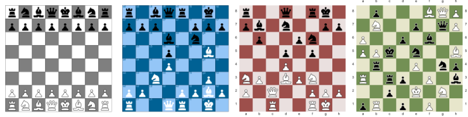

# QuickVectors.Patterns.FSharp

# ChessBoard

This type lets you define a pattern which looks like a chess board.

- The [ChessBoard Type](#the-chessboard-type)
    - [Fields](#fields)
    - [Construction](#construction)
    - [Deconstruction](#deconstruction)
    - [Variations](#variations)
    - [Generation](#generation)
    - [Post-generation Modifications](#post-generation-modifications)
    - [Ready-made Chess Board Patterns](#ready-made-chess-board-patterns)
- [Issues, Questions, and Suggestions](#issues-questions-and-suggestions)



(The designs created with this type aren't really 'patterns' as such but it's in the Patterns project
as I didn't want to create a new project just for this.)

## The ChessBoard Type

The `ChessBoard` **type** defines a record which is used to specify a chess board pattern.

### Fields 

The fields of the chess board pattern are as follows:

| Field Name            | Type                                                                                                          | Purpose / Defines                         |
| --------------------- | ------------------------------------------------------------------------------------------------------------- | ----------------------------------------- |
| **Arrangement**       | [ChessBoardArrangement](400-ChessBoardRelatedTypes.md "The ChessBoardArrangement type and module")            | The arrangement of pieces on the board    |
| **Sizing**            | [ChessBoardSizing](400-ChessBoardRelatedTypes.md "The ChessBoardSizing type and module")                      | The size of the board or squares          |
| **BoardColourWay**    | [ChessBoardColourWay](400-ChessBoardRelatedTypes.md "The ChessBoardColourWay type and module")                | How the board will look                   |
| **GridColour** **1*   | [Colour](../QuickVectors.Core.FSharp/040-Colour.md "The Colour type and module")                              | The colour of the board grid outline      |
| **PieceColourWay**    | [ChessPieceColourWay](400-ChessBoardRelatedTypes.md "The ChessPieceColourWay type and module")                | How the pieces will look                  |
| **AnnotationPolicy**  | [ChessBoardAnnotationPolicy](400-ChessBoardRelatedTypes.md "The ChessBoardAnnotationPolicy type and module")  | How the board will be annotated           |

- **1* : An Option field.

> **Note:** Some other types exist to support this pattern but they can be ignored as they are of no use to you 
and they might be no longer available at some point in the future.

Below is an example chess board pattern where all the values have been chosen manually:

```fsharp 
let whiteAndGrey = 
    {   Arrangement = ChessBoardArrangement.standardStart 
        Sizing = ChessBoardSizing.squareSize 100.0 
        BoardColourWay = ChessBoardColourWay.WhiteAndMidGrey 
        GridColour = Colour.black |> Some 
        PieceColourWay = ChessPieceColourWay.FilledAndWhiteWithBlackOutline 
        AnnotationPolicy = ChessBoardAnnotationPolicy.NoAnnotation } 
```

(The above example is the `ChessBoard.whiteAndGrey` ready-made pattern as mentioned below.)

### Construction

There are no construction functions, just specify the fields as you would with any normal F# record.

> **Note:** At least one chess board arrangement creation function can raise an exception if the input cannot
be parsed correctly. Becuase of this it is recommended that you evaluate the arrangement into a value before
using that value in this record. (It can also make debugging a little easier.)

### Deconstruction

There are no deconstruction functions for the type itself but you can deconstruct each field with the
deconstruction function appropriate for the type of that field or the fields in that type.

### Variations 

There are no functions for varying the values of the fields but you can, since all field values are type-checked and valid,
change the values in the same way as you would with any F# record.  
For example: `let newRecord = { oldRecord with FieldName = newValue }`.

Some convenience functions are available which can be useful:

- `withDifferentArrangement` : Uses a different arrangement;
- `withDifferentBoardColourWay` : Uses a different board colour way;
- `withDifferentPieceColourWay` : Uses a different piece colour way.

```fsharp 
ChessBoard.whiteAndGrey // A ready-made design.
|> ChessBoard.withDifferentArrangement 
        ChessBoardArrangement.medarKovalenko2016 // With a different arrangement.
```

### Generation 

You can generate the design information for a chess board pattern by using the
`ChessBoard.generate` function, passing in a `ChessBoard` type as the only parameter.

You would not usually need to investigate or manipulate the generated design information, rather you would
usually pass the design information into an export function in the `QuickVectors.Export.FSharp` package, like this:

```fsharp 
open System.IO // Required for the File functionality.
open QuickVectors.Patterns.FSharp // Required for generating the design.
open QuickVectors.Export.Svg.FSharp // Required for exporting.

ChessBoard.whiteAndGrey // A ready-made design.
|> ChessBoard.generate // Generate the design.
|> Svg.export SvgExportSettings.standard // Create the SVG text.
|> fun svg -> File.WriteAllText("ChessBoard.svg", svg) // Save to file.
```

If there is a problem generating or exporting the design then an exception will be raised.
Please report any exceptions along with the circumstances under which they occurred.

> **IMPORTANT:** The pattern itself does not contain any shapes/elements and is only a 'promise' of a design.
Shapes/elements are only created when you generate the pattern into a design.

### Post-generation Modifications

Once the design has been generated you can modify it via some functions.
If used, these functions must be used **after** the `generate` function has been used.

These functions are:

- `withBackground` : Add a colour-filled background to the design;

    More information about backgrounds can be found [here](491-Backgrounds.md).

- `withExtentsFrame` : Add a frame which delineates the extents of the pattern.

    More information about frames can be found [here](490-Frames.md).

## Ready-made Chess Board Patterns

The ready-made chess board patterns available are:

- `whiteAndGrey` : A standard starting position with white and grey squares.

You can make variations of these ready-made patterns or examine them to give you ideas
for your own patterns.

## Issues, Questions, and Suggestions

You can visit the *[QuickVectors.FSharp](https://github.com/GarryPatchett/QuickVectors.FSharp "Home page for the QuickVectors project")* GitHub repository to report issues, 
ask questions, or make suggestions. You can also read about the changes across different versions in the release notes there.